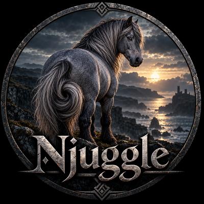

# Njuggle

Ghostty with vertical tabs.

## What is Njuggle?

Njuggle is a fork of Ghostty with vertical tabs, and that's about it.
There are also a few other minor enhancements included, which are
listed below.

Njuggle is regularly re-based on the latest libghostty and enjoys all
the performance enhancements being built upstream by that excellent
team.

The minor enhancements:

- A vertical tab sidebar with live titles and working directory.
- Tab colours, and tab renaming.
- Automatic tab grouping keyed by repository.
- A per-tab status icon: green while a command runs, red when one
  finishes needing attention.
- A border on the active tab.
- A border on the active pane.
- Dimming of inactive panes.
- Its own configuration file.

## What is a Njuggle?

A [njuggle](https://en.wikipedia.org/wiki/Nuggle) is a mythical
waterhorse of Scottish folklore. A nocturnal creature, thus best
enjoyed with a dark theme, he likes to play pranks and make mischief.
The bugs in this application are all his fault.

## Status icons

Each tab has its own Njuggle status icon, which is grey by default.
When a process is running in a tab, this icon changes to green. If
you switch to a different tab while the status icon is green, it will
then change to red when the long running process is complete. In this
way, you can easily see which tabs have active processes and which
need your attention. A notification bell will also turn the icon red,
because some things need your attention without a process running at
all. Once you've looked at the tab with the red icon, it returns to
grey.

## Configuration: Njuggle's own settings

**These options are Njuggle's own. Not one of them exists in Ghostty.**
With none of them set, Njuggle behaves as upstream Ghostty does. The
complete list follows.

`gtk-sidebar-tabs` is the switch for the sidebar itself:

```
gtk-sidebar-tabs = left
```

The value is `left`, `right` or `none`, and the default is `left`.
`none` means stock Ghostty behaviour, Njuggle's options below
included.

The rest fall into two groups. The first group is **off unless you add
it**: the line's presence is the switch, and deleting the line returns
stock behaviour.

`gtk-sidebar-active-tab-border` draws a 1px border around the active
tab's row in the sidebar:

```
gtk-sidebar-active-tab-border = #ff5500
```

Absent means no border. Any hex colour (`#RRGGBB` or `RRGGBB`) or named
X11 colour is accepted.

`active-pane-border` draws a 1px border around the focused pane of a
split tab, and the border follows focus:

```
active-pane-border = #ff5500
```

Absent means no border. Unfocused panes are unaffected by this option.

`inactive-pane-dim` dims the content of panes that do not have focus,
so the focused pane stands out:

```
inactive-pane-dim = true
```

The default is `false`. The strength follows `unfocused-split-opacity`
(Njuggle's default is 0.5) and the tint follows `unfocused-split-fill`,
so this boolean only switches the effect on and off. It applies to
multi-pane tabs only, and the focused pane is never dimmed.

The second group is **on unless you turn it off**: these already work
with no line in your file at all.

`gtk-sidebar-width` is the starting width of the sidebar in pixels:

```
gtk-sidebar-width = 0
```

The default width is a quarter of the window's width. Set a specific
starting width in pixels:

```
gtk-sidebar-width = 200
```

A non-zero value is the starting width in every new window, clamped
to at least 150px and at most half the window. Dragging the sidebar's
inner edge, or the `sidebar_resize` keybinding, changes the width for
the current session only; the value in this file is the starting
point.

`gtk-sidebar-status-icon` shows the per-tab status icon described under
[Status icons](#status-icons) above:

```
gtk-sidebar-status-icon = true
```

The default is `true`. Set it to `false` to hide the icon.

`gtk-sidebar-status-after` is how long a command must run in an
unfocused tab before its finish marks the tab as needing attention:

```
gtk-sidebar-status-after = 5s
```

The default is 5 seconds. Set it to `0` to mark every unfocused finish.
It requires `gtk-sidebar-status-icon`.

## Configuration: everything else is Ghostty

Njuggle uses its own config file, located at
`~/.config/njuggle/config`, which means it can live alongside Ghostty
with no clashes. Copy the contents of your existing Ghostty config, add
a few Njuggle specifics and enjoy.

**Everything else behaves exactly the same as Ghostty**: fonts, shell
integration, keybindings, themes, all other settings. For additional
help and information, see the Ghostty documentation at
https://ghostty.org/docs

One consequence of the separate config file: your font and theme
choices live in the Ghostty config, so copy them across to
`~/.config/njuggle/config` when you first set it up. That is the copy
described in the paragraph above.

## Building from source

Requirements: Debian 13 (Trixie) or any distro with GTK 4.18 and
libadwaita 1.7; Zig at the version pinned in `build.zig.zon`
(`.minimum_zig_version`); blueprint-compiler >= 0.16;
libgtk4-layer-shell; gettext; pkg-config.

Njuggle uses the GPU renderer (OpenGL 4.3+ via EGL), the same
requirement as Ghostty 1.4. On machines without a usable GPU or EGL
path, try [Monstar](https://github.com/rockorager/monstar), a
CPU-rendered Wayland terminal built on libghostty.

```
git clone https://github.com/phillc73/njuggle
cd njuggle
zig build -Doptimize=ReleaseFast --search-prefix "$HOME/.local"
```

The binary lands at `zig-out/bin/njuggle`. ReleaseFast is required:
debug builds are about 5x larger and warn about performance on every
launch.

To build and install in one step, give the build the path the binary
should live at:

```
zig build -Doptimize=ReleaseFast -Dinstalled-exe-path="$HOME/.local/bin/njuggle" --search-prefix "$HOME/.local"
```

That installs the binary, the desktop entry, the matching D-Bus service
file, the hicolor icons, and a default config at
`~/.config/njuggle/config` if you do not already have one. An existing
config is never overwritten. Copying `zig-out/bin/njuggle` into
`~/.local/bin` by hand works too, if you only want the binary.

## Releases

The first release is built from source. CI-built binaries (a Linux
tarball, possibly Flatpak) are planned if there is interest. There is
no macOS build: the sidebar is GTK-only and targets Linux and
Unix-like systems.

## Parity with Ghostty

`gtk-sidebar-tabs = none` makes Njuggle's tabbed behaviour match
upstream Ghostty. The automated check (`scripts/check-none-parity.sh`)
guards this. Njuggle-only options (borders, dimming) can still be set
in `none` mode; with none of them set, `none` mode is Ghostty.

## Lineage and attribution

Based on Ghostty 1.4.0.

- Ghostty upstream: Mitchell Hashimoto and contributors,
  https://github.com/ghostty-org/ghostty, MIT, copyright preserved.
- The archived fork this continuation came from:
  https://github.com/geremyturcotte/ghostty-linux-vertical-tabs, MIT,
  archived October 2026; the original vertical-tabs work is theirs.
- Njuggle: maintained rebase of that sidebar series onto current
  Ghostty releases.

Njuggle has its own version, independent of the Ghostty release it is
based on. This release is Njuggle 0.1.0, based on Ghostty 1.4.0; the
Ghostty base moves with each rebase without moving Njuggle's version.
The build reports both: `+version` prints `0.1.0+ghostty.1.4.0`.

## Known limits

- The fetched glslang build carries a local `-O0` patch on
  `SPIRV/doc.cpp` for Zig 0.17, which compiles that one file without
  optimization. It is a workaround for a Zig compile failure, it costs
  nothing at runtime, and it will be removed when a Zig release no
  longer needs it.
- The full test suite needs a machine with more than 11 GB of RAM.

## License

Njuggle's own work is licensed under the GNU Affero General Public
License, version 3: see [LICENSE](LICENSE).

The code inherited from Ghostty and from the archived fork is MIT
licensed, copyright preserved, and its licence text is in
[LICENSE-Ghostty](LICENSE-Ghostty).

## AI assistance

This project, including the reproduction, the rebase and this text, was
written with the assistance of a large language model and reviewed by
its maintainer.
